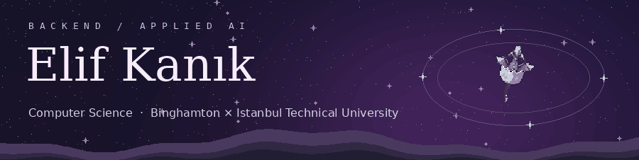
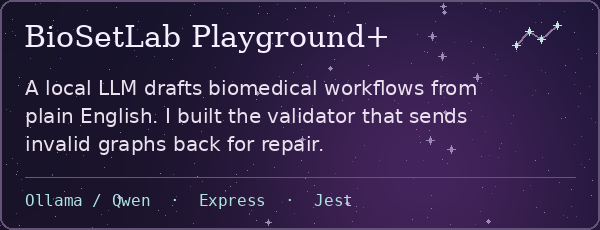
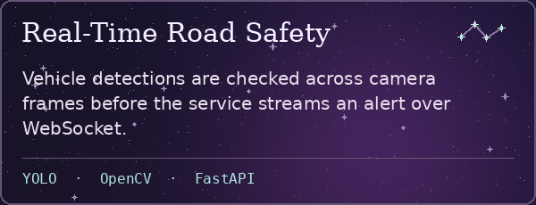
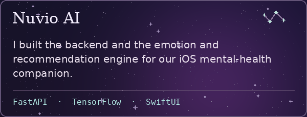
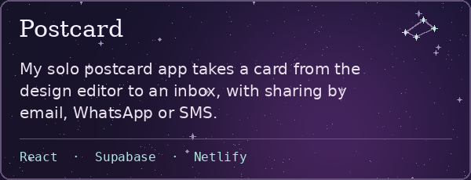

<!-- elif-dragon:start -->
**1-day contribution streak** · Hatchling · Next stage at 7 days

<!-- elif-dragon:end -->

I build systems that hand work to AI models and keep a human in the loop.

<a href="https://www.linkedin.com/in/elifkanik101">LinkedIn</a> · <a href="mailto:kanikelif10@gmail.com">Email</a>

## Selected projects

<table>
<tr>
<td width="50%"></td>
<td width="50%"></td>
</tr>
<tr>
<td width="50%"></td>
<td width="50%"></td>
</tr>
</table>

## Experience

| Team | My work |
| --- | --- |
| **Mirabito Energy Products** · Backend intern | Nine-state billing workflow and AI integration · Django REST, PostgreSQL |
| **PortX** · AI intern | Validated 1,200+ labeled examples for Llama 3.2 information extraction |
| **Washington University in St. Louis** · Research contributor | Tabular data to images for CNNs and explainability |
| **ITU Graduate School** · Part-time | Web, campus television and AI projects |

## Beyond code

Photography · graphic design · creative visuals  
Seven years captaining an underwater rugby and hockey team · university snowboard team
